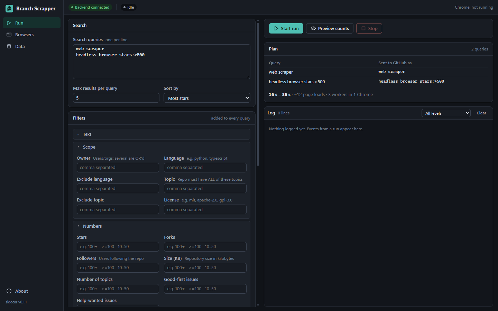
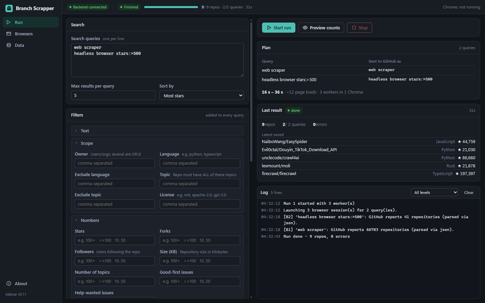
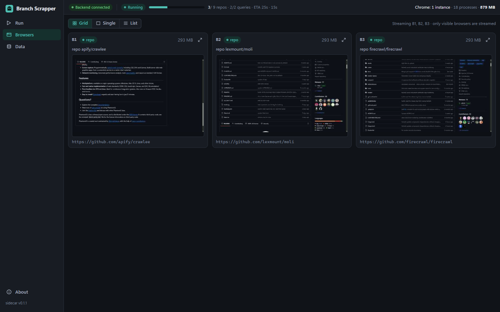
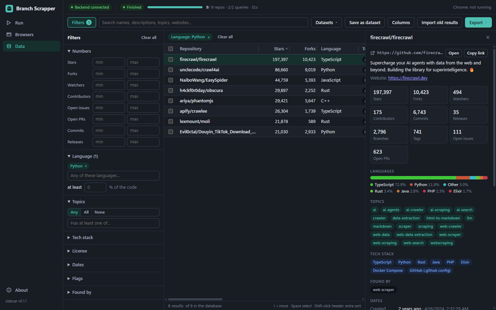

# Branch Scrapper

(Formerly "Ghost Scraper" up to v0.1.0; see [upgrading](#upgrading-from-ghost-scraper-010).)

A Windows desktop app that searches GitHub for repositories and collects, per repo: link, description,
website, stars, forks, watchers, branches, tags, releases, commits, contributors, open issues/PRs, languages (%),
detected tech stack, topics, licence, default branch and created / last-commit dates. It drives a real,
hidden Chrome over the DevTools Protocol (Zendriver) instead of calling the API, stores everything in a local
SQLite database, and lets you search, filter and export it. The same scraper core is also available as a
command-line tool.

<p align="center">
  <a href="docs/media/branch-scrapper-promo.mp4">
    
  </a>
  <br>
  <sub><a href="docs/media/branch-scrapper-promo.mp4">Watch the full-quality video with sound (MP4)</a> ·
  <a href="https://github.com/abhishekairan/Branch-Scrapper/releases/latest">Download the latest release</a></sub>
</p>









## Features

- **Run screen**: enter queries and filters (the same names as `gh search repos`), with validation before you
  start and a **Preview counts** button that loads only page 1 of each search and shows GitHub's match count.
- **Live browser tiles**: the scraper's Chrome windows are parked off-screen; the Browsers screen streams them
  as tiles, only while a tile is visible, and **Take control** lets you click and type in one (for example to
  sign in to GitHub).
- **Shared Chrome contexts**: several workers run as separate browser contexts inside one Chrome to save RAM
  (an isolated Chrome per worker is an option).
- **Data screen**: full-text search, filters, saved datasets, a detail drawer, JSON and CSV export, and import of
  results saved by the old command-line scraper.
- **CLI**: the original command-line interface still works from a source checkout (see below).

## Download and install (Windows)

1. Download `Branch Scrapper_<version>_x64-setup.exe` (on the Releases page the file name has no space:
   `BranchScrapper_<version>_x64-setup.exe`) from the
   [Releases page](https://github.com/abhishekairan/Branch-Scrapper/releases).
2. Run it. It installs per user, no administrator rights needed.
3. The installer is **not code-signed**, so Windows SmartScreen shows "Windows protected your PC". Click
   **More info**, then **Run anyway**.

Requirements: Windows 10/11 x64, and Google Chrome (or Microsoft Edge / Brave). WebView2 is preinstalled on
Windows 11; the installer downloads its bootstrapper if it is missing. No Python is needed.

The installer is about 18 MiB and uses about 51 MB installed (measured, see `packaging/README.md`).

**Where your data lives:** `%APPDATA%\BranchScrapper` (`data.db`, `config.json`, `logs\`). It is kept when you
uninstall; delete the folder yourself to remove it.

### Upgrading from Ghost Scraper 0.1.0

Just run the new installer. It silently removes the old Ghost Scraper program (not your data), and on its first
start Branch Scrapper copies `%APPDATA%\GhostScraper` to `%APPDATA%\BranchScrapper`. The old folder is left in
place with a `MIGRATED_TO.txt` note; delete it once you have checked that everything is there. UI preferences
such as the Browsers layout are reset once.

## Platform status

Windows is the only tested platform. Linux and macOS are planned but not supported yet.

## Build from source

Full steps, prerequisites and measured sizes are in [`packaging/README.md`](packaging/README.md). In short:
Python 3.12 venv, Rust (MSVC), Node 22; freeze the sidecar with `packaging\build_sidecar.py`, then
`npx tauri build` in `app/`.

To run the app in development (uses `.venv\Scripts\python.exe -m ghscraper.sidecar` as the backend):

```powershell
py -3.12 -m venv .venv
.\.venv\Scripts\python.exe -m pip install -r requirements.txt
cd app
npm ci
npx tauri dev
```

## Command-line usage

Needs the Python venv from above and Chrome (or Edge/Brave via `--browser msedge|brave`, or `browser_path` in
`config.json`). There is no chromedriver; nothing is downloaded on first run.

```powershell
# Interactive menu (search, headless toggle, settings editor)
.\.venv\Scripts\python.exe main.py

# One-shot, flags override config.json for this run only
.\.venv\Scripts\python.exe main.py -q "web scraper" -n 50 --language python --sort stars --headless

# Several queries (comma/semicolon list, repeated -q, or a file) across 4 browsers
.\.venv\Scripts\python.exe main.py -q "web scraper, selenium stealth" -q "cli tool" -n 20 -b 4 --headless
.\.venv\Scripts\python.exe main.py --queries-file queries.txt -b 3
.\.venv\Scripts\python.exe main.py -h
```

Query syntax: separate queries with `;` or commas (commas inside a qualifier such as `in:name,description`
stay part of that query), repeat `-q`, or use `@queries.txt` / `--queries-file`. Qualifiers can be written
inline (`shop topic:ecommerce stars:>20`).

### Filters

Filters apply to every query, are saved in `config.json` (`filters`), and use the same names as `gh search repos`.

| Flag | GitHub qualifier | Example |
|---|---|---|
| `--topic` / `--exclude-topic` | `topic:` / `-topic:` (all required) | `--topic nextjs,gsap` |
| `--language` / `--exclude-language` | `language:` | `--language python` |
| `--owner` | `user:` | `--owner vercel` |
| `--license` | `license:` | `--license mit,apache-2.0` |
| `--match` | `in:` | `--match name,description` |
| `--stars` `--forks` `--followers` `--size` (KB) `--number-topics` `--good-first-issues` `--help-wanted-issues` | numeric | `100`, `100+`, `>=100`, `<50`, `10..50`, `1.5k` |
| `--created`, `--pushed` (alias `--updated`) | dates | `2024-01-01`, `"before 2024-01-01"`, `"after 30d"`, `"since 6m"`, `"within 1y"`, `"between 2024-01-01 and 2024-06-30"` |
| `--archived true\|false` | `archived:` | |
| `--include-forks false\|true\|only` | `fork:` (GitHub hides forks by default) | |
| `--template`, `--mirror` | `template:`, `mirror:` | |
| `--sponsorable`, `--funding-file` | `is:sponsorable`, `has:funding-file` | |
| `--qualifier` | anything else, raw | `--qualifier "-language:php topics:>3"` |

Sort with `--sort stars|forks|updated --order desc|asc`. `--count` (alias `--dry-run`) previews match counts
only, `--clear-filters` ignores saved filters, `--save` stores the flags' settings in `config.json`.

- Relative dates (`30d`, `2w`, `6m`, `1y`) stay relative in the config and resolve on each run.
- Prefer the word forms (`before ...`) on Windows: `<` and `>` are redirects in cmd and need quoting.
- GitHub never reports a bad qualifier value: `stars:abc` silently returns 0 results. The scraper validates
  every filter before running and flags queries that match 0.

### Workers, browsers and proxies

- `browsers` (1-5, `-b N`) parallel workers share one task queue. `workers_per_chrome` (default 3) workers share
  one Chrome as separate contexts; `--isolate-workers` gives each worker its own Chrome and profile.
- A rate-limit hit pauses every session sharing that exit IP. Comma-separate proxies to give each browser its
  own IP. All sessions share your IP otherwise, so raise `min_delay`/`max_delay` if you see back-off messages.
- `user_data_dir` keeps a persistent Chrome profile. Logged-in profiles have not been tested end to end.
- Chrome processes are placed in a Windows job object so closing or killing the scraper does not leave
  browsers behind.

Results from the CLI go to `output/<query>_<timestamp>.json` and `.csv`.

### Limits

- GitHub search returns at most 1000 results (100 pages of 10 when logged out).
- Deep scrape costs one page load per repo (about 3-8 s each with default delays).

### Tests

Offline parser and core tests (re-capture the fixtures in `tests/fixtures` if GitHub changes its markup):

```powershell
.\.venv\Scripts\python.exe -m unittest discover tests
```

## Responsible use

Respect GitHub's [Terms of Service](https://docs.github.com/en/site-policy/github-terms/github-terms-of-service)
and rate limits. This tool is meant for personal research. For large-scale or commercial collection, use the
official REST/GraphQL API (5000 requests/hour with a token), which is the sanctioned route. You are responsible
for how you use it.

## Support

Branch Scrapper is free. If it is useful to you, you can support its development, entirely optionally:

- [Buy Me a Coffee](https://buymeacoffee.com/abhishekairan)
- [PayPal](https://paypal.me/AbhishekAiran001)
- UPI: `abhishekairan1234@okhdfcbank`

Thank you. Bug reports and starring the repo help just as much.

## Licence

GNU Affero General Public License v3.0 (see [`LICENSE`](LICENSE)). In plain terms: you may use, modify and
redistribute it, but forks and redistributed copies must stay open source under the same licence. The licence
is AGPL because the installer bundles [Zendriver](https://github.com/cdpdriver/zendriver), which is AGPL-3.0.
Third-party components and their licences are listed in [`THIRD_PARTY_NOTICES.md`](THIRD_PARTY_NOTICES.md).
